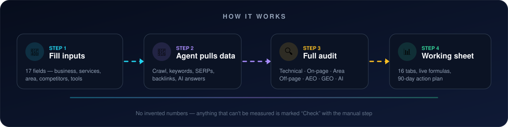
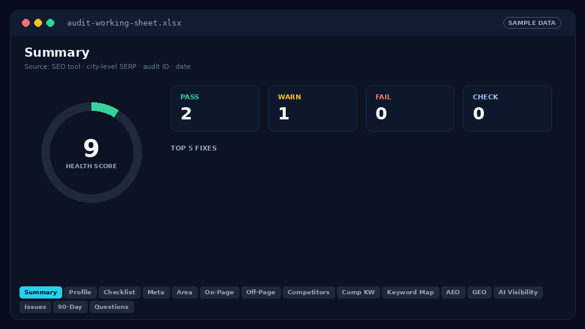

<div align="center">


<br/>

[](CHANGELOG.md)
[](LICENSE)
[](docs/workbook-structure.md)
[](#-whats-inside-the-audit)

[](#-requirements)
[](#-requirements)
[](#-requirements)
[](CONTRIBUTING.md)

### Turn any AI agent into a senior SEO consultant — and get a client-ready Excel working sheet back.

[**🚀 Get the prompt**](prompt.md) · [**📝 Inputs template**](templates/client-inputs.md) · [**💡 Example**](examples/example-inputs.md) · [**📊 Workbook spec**](docs/workbook-structure.md)

</div>

---

## ✨ Why this exists

Auditing a local business properly means juggling crawlers, keyword tools, SERPs, Google Business Profile, backlinks — and now **AI answers** from ChatGPT, Perplexity, Gemini and Google AI Overviews. This prompt bundles all of it into **one repeatable run** that produces the same structured, formula-driven deliverable every time.

<table>
<tr>
<td width="33%" valign="top">

### 🔎 SEO
24 technical checks, page-by-page meta audit, service-area accuracy, off-page, competitors and a keyword map where every keyword has **one** target URL.

</td>
<td width="33%" valign="top">

### 💬 AEO
Answer Engine Optimisation — People Also Ask questions, 40–60 word direct answers, FAQ schema and featured-snippet targets, page by page.

</td>
<td width="33%" valign="top">

### 🤖 GEO
Generative Engine Optimisation — entity consistency, `llms.txt`, AI crawler access, E-E-A-T, and AI share of voice across 5 engines.

</td>
</tr>
</table>

---

## ⚙️ How it works

<div align="center">

</div>

---

## 📊 See the working sheet

<div align="center">

<br/><sub><i>Illustrative preview with sample data — your workbook is built from live data for your client.</i></sub>
</div>

<br/>

<details>
<summary><b>📑 All 16 tabs — click to expand</b></summary>

<br/>

| # | Tab | What's in it |
|:-:|-----|--------------|
| 1 | 🏠 **Summary** | Key numbers, client inputs, health score, checklist counts, top 5 fixes |
| 2 | 🏢 **Business Profile** | NAP, ABN, hours, USPs, guarantees, sectors — with source per field |
| 3 | ✅ **Audit Checklist** | 24 technical tests, Pass / Warning / Fail / Check, score formulas |
| 4 | 🏷️ **Page Meta Audit** | Every sitemap URL — titles, descriptions, H1s, word counts, `LEN()` formulas |
| 5 | 📍 **Area Check** | Service-area accuracy: wrong suburbs, regions, out-of-area mentions |
| 6 | 🛠️ **On-Page Issues** | Page-level fixes |
| 7 | 🔗 **Off-Page** | Backlinks, Google Business Profile, citations, reviews, link opportunities |
| 8 | 🥊 **Competitor Audit** | 8–10 competitors from the city-level SERP, averages, client vs average |
| 9 | 🎯 **Competitor Keywords** | Competitor targets with an "Opportunity?" formula |
| 10 | 🗺️ **Keyword Map** | Every keyword mapped to one URL, difficulty bands, cluster totals |
| 11 | 💬 **AEO** | Questions, direct-answer status, FAQs to add, snippet opportunities |
| 12 | 🧠 **GEO** | Entity consistency, schema `sameAs`, llms.txt, AI crawlers, E-E-A-T |
| 13 | 🤖 **AI Visibility** | AI Overviews, AI Mode, ChatGPT, Perplexity, Gemini + 20–30 prompts |
| 14 | 🚨 **Issues & Fixes** | Everything combined and prioritised (High / Medium / Low / Info) |
| 15 | 📅 **90-Day Action Plan** | Quick wins, month 1–3, owner and expected impact |
| 16 | ❓ **Open Questions** | Things the client must confirm |

Full column-by-column breakdown → [`docs/workbook-structure.md`](docs/workbook-structure.md)

</details>

---

## 🚀 Quick start

```text
1. Copy      →  prompt.md
2. Fill      →  the 17 Client Inputs (blanks are OK)
3. Paste     →  into an AI agent with SEO tools + code execution connected
4. Upload    →  any extras: AI-answer screenshots, GBP exports, past reports
5. Receive   →  one .xlsx working sheet + a short summary
```

> [!TIP]
> Missing inputs are fine. The agent checks the website, uploaded files and connected tools first — and only asks you for what it truly can't find.

**The summary you get back:** health score · 5 biggest problems · 3 quickest wins · position vs competitors and in AI answers · anything that couldn't be checked, with the manual step.

---

## 🧩 What's inside the audit

| Section | Covers |
|:-:|---|
| **A** | Business profile — client vs site-sourced facts |
| **B** | 24-point technical audit + broken links, canonicals, orphans, JS-rendered "0" counters |
| **C** | Page-by-page on-page audit with cannibalisation flags |
| **D** | Service-area accuracy — wrong regions, council names, out-of-area mentions |
| **E** | Off-page — backlinks, GBP, citations, NAP, reviews vs competitors |
| **F** | Competitor audit from the **city-level** SERP + their top keywords |
| **G** | Keyword research mapped to URLs, with gaps for new pages |
| **H** | AEO — questions, direct answers, FAQs, featured snippets |
| **I** | GEO — entities, `sameAs`, `llms.txt`, AI crawlers, E-E-A-T, citable content |
| **J** | AI visibility — 20–30 real prompts, who's cited, AI share of voice |
| **K** | Prioritised issues + 90-day action plan with owners |

---

## 🧰 Requirements

The prompt is built around **live data, not guesses**.

| Need | Examples |
|------|----------|
| 🕷️ Site crawler / audit | SE Ranking Website Audit, Screaming Frog, Sitebulb |
| 📈 Keywords, competitors, SERPs | SE Ranking, Semrush, Ahrefs, DataForSEO |
| 🤖 AI search visibility | SE Ranking AI Search / AI Results Tracker, or manual checks |
| 🌐 Web fetch | To read real pages, robots.txt, sitemap.xml, llms.txt |
| 📊 Spreadsheet generation | Code execution with `openpyxl` (or equivalent) |
| ➕ Optional | Google Search Console, GA4, PageSpeed Insights, GBP access |

> [!NOTE]
> If a tool isn't available, the agent marks that item **"Check"** and gives you the manual step — it never invents numbers.

Tested with Claude (SEO MCP connector + code execution). Should work with any capable agent that has equivalent tools.

---

## 🛡️ Rules baked in

- ✅ **Live data only** — crawl the site, read real pages, pull real keyword and SERP data
- 📍 **City-level SERPs**, not just country level — critical for local businesses
- 🚫 **No invented numbers** — unmeasurable items are marked "Check" with a manual step
- 🧾 **Every table cites its source and date** (tool, database, audit ID, date)
- 🥇 **Client priorities first** — primary service, then secondary; primary audience first
- ⚠️ **Flags content for services the client doesn't offer**
- 🗣️ **Writes in the client's local English** (e.g. Australian English)
- 🧮 **Formulas, not hardcoded totals** — zero formula errors before delivery

---

## 🎛️ Customising

| Want to… | Do this |
|---|---|
| 🌍 **Audit another country** | Change *Country / search database* and the local English rule. Swap section E directories for local ones — Checkatrade/Trustpilot (UK), Angi/Yelp (US), JustDial/Sulekha (India). |
| 🏬 **Audit a non-local business** | Drop section D (Service Area) and the city-level SERP rule. |
| ⚡ **Run a lighter audit** | Remove tabs from section 4 — but keep section 3 K (Issues & Action Plan). |
| 📏 **Change thresholds** | Adjust title (65 chars), description (158 chars) and thin content (600 words) in sections B and 4. |

---

## 📁 Repo structure

```
.
├── README.md                  ← you are here
├── prompt.md                  ← the full prompt (copy this)
├── assets/                    ← banner, diagram and workbook preview
├── templates/
│   └── client-inputs.md       ← blank inputs block + field guide
├── examples/
│   └── example-inputs.md      ← filled-in example (fictional business)
├── docs/
│   └── workbook-structure.md  ← every tab and column explained
├── .github/ISSUE_TEMPLATE/    ← issue template
├── .gitignore                 ← keeps client .xlsx/.csv files out of the repo
├── CHANGELOG.md
├── CONTRIBUTING.md
└── LICENSE
```

---

## 🤝 Contributing

Improvements welcome — new checks, better thresholds, country-specific directory lists, or results from other AI agents. See [`CONTRIBUTING.md`](CONTRIBUTING.md).

<div align="center">

### ⭐ If this saves you hours on your next audit, give the repo a star.

**[MIT License](LICENSE)** — free to use, modify and share, including for client work.

</div>
